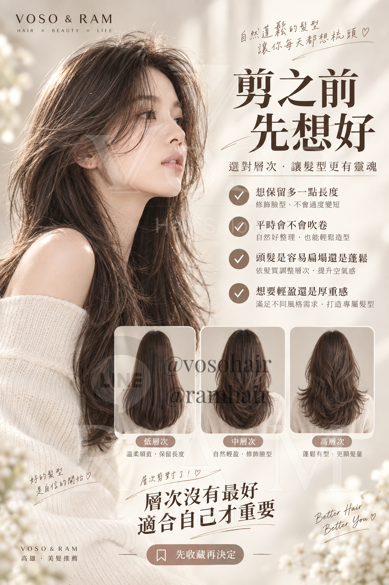

# 高雄層次剪髮攻略｜適合各臉型的層次髮型，修飾臉型好整理

高雄VOSO HAIR（左營）、RAM HAIR STUDIO（鼓山）很多客人都會問：什麼是層次剪？層次剪不是單純打薄，是透過長短落差的剪裁，讓頭髮產生立體蓬鬆感，還能針對臉型做層次調整，也是高雄客人最常預約的剪髮項目。

## 什麼是層次剪髮？
層次剪髮，就是透過長短落差的剪裁，讓頭髮產生立體感與蓬鬆度。
不是把頭髮打薄、削短，而是利用長短線條，修飾臉部輪廓，同時減輕髮尾重量，在家更好吹打理。
依照長短落差分為三種：高層次、中層次、低層次。

## 不同臉型適合的層次髮型
### 圓臉｜適合高層次、臉側碎層
圓臉重點是拉長臉部視覺，避免兩側過蓬。
建議耳上開始帶層次，臉側保留碎髮，縮短臉寬視覺，搭配側分效果更佳。

### 方臉｜適合中層次，柔化下顎角
方臉下顎線條明顯，要用柔和的碎層遮蓋角感。
不要太淩厲的高層次，選擇中層次，髮尾帶柔和碎線，弱化方下巴。

### 長臉｜低層次優先，不要頂部太高
長臉要避免頭頂過度蓬鬆，優先選低層次。
層次放在髮尾，保留頭髮重量，兩側製造蓬度，平衡臉部長度。

### 菱形臉｜中高層次，填補顴骨上下空洞
菱形臉顴骨較突出，層次重點放在顴骨上下。
利用碎髮柔化顴骨，不要讓髮線貼臉，兩側增加厚度。

## 高層次、中層次、低層次差異

**高層次**：層次起點高（靠近頭頂），蓬鬆感最強，適合圓臉、髮量厚重的人。缺點：長髮容易毛躁，需要簡單造型。

**中層次**：層次大約在耳位，是最多高雄客人選擇的款式，兼顧蓬鬆與好整理，大部分臉型都適合。

**低層次**：層次只在髮尾，頭髮保留重量，線條穩定，適合長臉、喜歡順直質感、不想太毛的客人。

## 高雄層次剪髮常見QA
Q：層次剪等於打薄嗎？
A：完全不一樣。打薄是削減髮絲數量，容易毛躁；層次剪是改變頭髮長度，創造線條。

Q：細軟髮適合層次剪嗎？
A：可以，建議中低層次，不要太高層次，避免頭髮更貼。

Q：粗硬自然捲可以做層次？
A：建議中層次，設計師會控制落差，避免毛炸，可搭配離子燙柔和線條。

## 高雄預約層次剪髮
左營 VOSO HAIR｜裕誠路280號
鼓山 RAM HAIR STUDIO｜南屏路266號
預約層次剪髮，可提前備註你的臉型、髮質與日常打理習慣，設計師會給適合你的客製層次方案。
